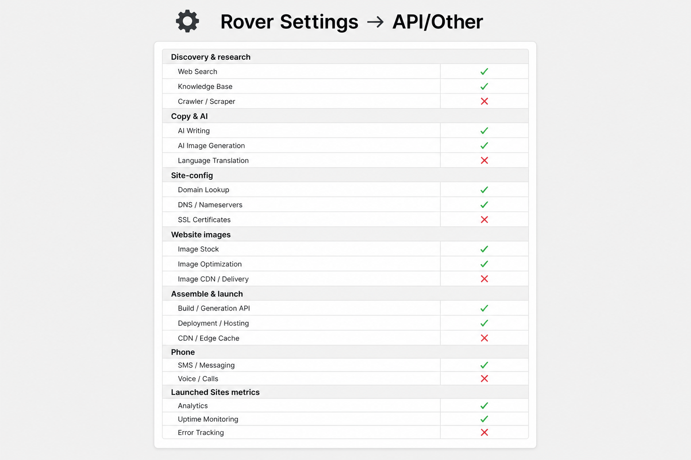
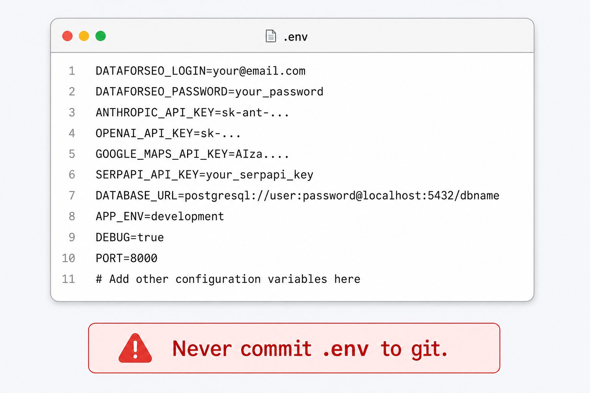
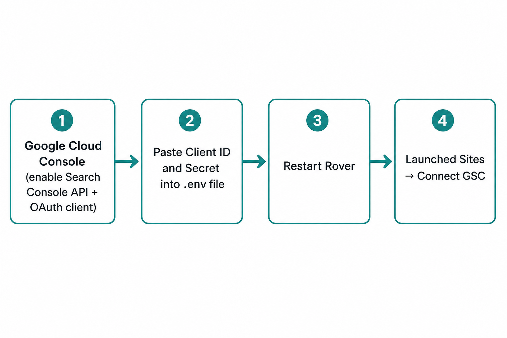

# Rover .env & API keys setup

This guide walks you through every key Rover needs in your local `.env` file. You do not need to be a developer — follow the numbered clicks, paste values into `.env`, then check the gear in Rover.

For the product walkthrough (what to click in Discovery → Launch), see [USER-GUIDE.md](USER-GUIDE.md). Time estimates: [USER-FLOW.md](USER-FLOW.md). New operators: start from the [GitHub access gateway](GITHUB-ACCESS-GATEWAY.md) if you do not have repo access yet.

Sections match **Settings → API/Other** (same order as the green ✓ / red ✕ list).



---

## Who this is for

Anyone running Rover on their machine who needs Discovery, site addresses, website images, Launch, Phone, or Launched Sites metrics to show green in Settings.

## Prerequisites

1. Open the **Rover** project folder in Cursor or VS Code (`C:\Repos\Rover` or wherever you cloned it).
2. If there is no `.env` file in that folder yet:
   - Find `.env.example` in the same folder.
   - Copy it and rename the copy to `.env` (keep `.env.example` as-is).
3. Plan to **restart Rover** after every change to `.env` (`Ctrl+C` in the terminal, then `npm run rover` again). Settings only reloads env values on startup.

## How to edit `.env` on Windows

1. In Cursor/VS Code, open `.env` from the Rover folder root (same level as `package.json`).
2. Put **one setting per line**, in the form `NAME=value` with no spaces around `=`.
3. Do **not** wrap values in quotes unless the value itself contains spaces (most keys never need quotes).
4. Use placeholders from this guide (`sk-ant-…`, `AIza…`) — never paste real secrets into docs, chat, or git.
5. Save the file (`Ctrl+S`).
6. Restart Rover.



**Security**

- Do **not** commit `.env`. It is gitignored on purpose.
- GSC login tokens live under `research/` (also gitignored). Do not share that folder.

## How to verify

1. Start Rover: `npm run rover`.
2. Open the dashboard (usually `http://127.0.0.1:8787`).
3. Click the **gear** (Settings).
4. Open **API/Other**.
5. Walk the groups below — each item should turn **green ✓** when that section’s variables (and, for Search Console, Connect GSC) are done.

---

## 1. Discovery & research — DataForSEO

### What it’s for

Powers Discovery SERP probes, keyword research, enrichment, and Launched Sites **keyword rank** checks.

### Required?

**Required** for Discovery / research and rank tracking. Without it, those stages stay blocked.

### Env variable names

```env
DATAFORSEO_LOGIN=
DATAFORSEO_PASSWORD=
```

### Steps

1. Open [DataForSEO API Access](https://app.dataforseo.com/api-access).
2. Sign up or log in.
3. On the API access page, copy your **login** (usually your email) and **password** / API password (not your website password if they differ — use the values shown on that page).
4. Fund the products you use (at minimum **SERP** and **Keywords Data**; Backlinks for enrich; Maps SERP for prospect renters — see comments in `.env.example`).
5. Paste into `.env` as shown under **Where to paste**.
6. Save and restart Rover.

### Links

- [DataForSEO API Access](https://app.dataforseo.com/api-access)
- [DataForSEO docs](https://docs.dataforseo.com/v3/)

### Where to paste

```env
DATAFORSEO_LOGIN=you@example.com
DATAFORSEO_PASSWORD=your-api-password-here
```

### How Settings shows ✓

**Discovery & research → DataForSEO** is green when both variables are non-empty.

---

## 2. Copy & AI — Anthropic

### What it’s for

Claude drafts site narrative, outreach, and other copy in Rover (draft → Accept).

### Required?

**Required** for AI copy / narrative flows. Optional only if you never use those features.

### Env variable names

```env
ANTHROPIC_API_KEY=
# ANTHROPIC_WORKSPACE_ID=wrkspc_…
# ANTHROPIC_MODEL=claude-sonnet-5
# ANTHROPIC_EFFORT=medium
```

Default model is Claude Sonnet 5 at medium effort. Leave `ANTHROPIC_MODEL` / `ANTHROPIC_EFFORT` unset unless you need an override.

Identity-linked keys (personal or service-account) that are not scoped to one workspace need `ANTHROPIC_WORKSPACE_ID`. Copy the `wrkspc_…` id from Console **Settings → Workspaces**. Workspace-scoped keys do not need this. Restart Rover after changing `.env`.

### Steps

1. Open [Anthropic Console](https://console.anthropic.com/).
2. Sign up or log in.
3. Go to **API keys** (or **Settings → API keys**).
4. Click **Create Key** (or **Create API key**).
5. Copy the key once (starts with `sk-ant-`). Store it somewhere safe; you may not see it again.
6. Paste into `.env`, save, restart Rover.
7. If Suggest domains / Narrative / Write site returns “workspace-id is required”, add `ANTHROPIC_WORKSPACE_ID=wrkspc_…` from **Settings → Workspaces** and restart Rover.

### Links

- [Anthropic Console](https://console.anthropic.com/)
- [API keys](https://console.anthropic.com/settings/keys)
- [Workspaces](https://console.anthropic.com/settings/workspaces)
- [Authentication (workspace header)](https://platform.claude.com/docs/en/manage-claude/authentication)

### Where to paste

```env
ANTHROPIC_API_KEY=sk-ant-api03-…
# ANTHROPIC_WORKSPACE_ID=wrkspc_…
# ANTHROPIC_MODEL=claude-sonnet-5
# ANTHROPIC_EFFORT=medium
```

### How Settings shows ✓

**Copy & AI → Anthropic** is green when `ANTHROPIC_API_KEY` is set.

### Optional: API Cost balance (Admin key)

By default Rover shows **PAYG** for Anthropic in the API Cost table. `ANTHROPIC_ADMIN_KEY` is the only extra key (not `ANTHROPIC_ADMIN_API_KEY`). Anthropic’s Admin API does not currently return prepaid organization credits, so Balance stays **—**. Spent uses Rover-recorded totals.

1. Open [Anthropic Console → Settings → Admin keys](https://console.anthropic.com/settings/admin-keys).
2. You must be an **organization admin / owner** to create admin keys.
3. Click **Create key**, give it a name, and copy the secret (starts with `sk-ant-admin01-…`). It is shown only once.
4. Add to `.env`:

```env
ANTHROPIC_ADMIN_KEY=sk-ant-admin01-…
```

5. Save and restart Rover. Spent stays Rover-recorded. Balance stays **—** until Anthropic exposes prepaid credits on the Admin API (the Console billing page is not available via `ANTHROPIC_ADMIN_KEY`).

Optional: `ANTHROPIC_CREDIT_BALANCE=100` (total purchased credits in USD) if you want Rover to compute `credits − month-to-date spend` when the Admin API does not return a credit cap.

---

## 3. Site-config · address — Google Maps & Apify

You can still use **Manual commercial**, **home paste**, recover / Use anyway, or **Skip** without these. **Find addresses** needs Google Maps + Apify token and at least one of LoopNet / Crexi actor ids.

### 3a. Google Maps (Places)

#### What it’s for

Screens and validates commercial address candidates in Site-Config → Address. Each **Find** / **Fetch deeper** pulls and Places-checks up to **40 listings** total (LoopNet ~20/URL × office+retail; Crexi 40/URL). A street is rejected only when Places returns an **OPERATIONAL** Maps listing locked to that street number + ZIP (not temp/permanent closed). After a Places-clean pass, **Geocoding** resolves Maps locality so suburb mismatches land in the **Secondary** tier (metro radius only).

#### Required?

**Required for Find addresses.** Optional if you only paste/skip/manual.

#### Env variable names

```env
GOOGLE_MAPS_API_KEY=

# Optional: max Places Text Search calls per Address Find/Screen run (default 40 = listings batch).
# PLACES_BUDGET_PER_RUN=40
```

#### Steps

1. Open [Google Cloud Console](https://console.cloud.google.com/).
2. Create a project (or select one) and enable **billing** for that project.
3. Open [Places API (New)](https://console.cloud.google.com/apis/library/places.googleapis.com) → **Enable**. Also enable [Geocoding API](https://console.cloud.google.com/apis/library/geocoding-backend.googleapis.com) (Maps locality / Secondary tier).
4. Go to **APIs & Services → Credentials → Create credentials → API key**.
5. Restrict the key to **Places API (New)** and **Geocoding API** (recommended).
6. Copy the key into `.env`, save, restart Rover.

#### Links

- [Places API (New) library](https://console.cloud.google.com/apis/library/places.googleapis.com)
- [Credentials](https://console.cloud.google.com/apis/credentials)

#### Where to paste

```env
GOOGLE_MAPS_API_KEY=AIza…
```

#### How Settings shows ✓

**Site-config · address → Google Maps** is green when the key is set.

---

### 3b. Apify (LoopNet + Crexi)

#### What it’s for

Pulls commercial listing candidates for the address finder from **LoopNet** and/or **Crexi** (Address step toggles). Same Apify token for both actors.

#### Required?

**Required for Find addresses** (together with Google Maps): `APIFY_TOKEN` plus **at least one** of `APIFY_LOOPNET_ACTOR_ID` / `APIFY_CREXI_ACTOR_ID`. Optional if you only paste/skip/manual.

#### Env variable names

```env
APIFY_TOKEN=
APIFY_LOOPNET_ACTOR_ID=
# Optional. Used when Solidcode’s latest build is still the July 31 1.0.2 actor, or a newer build returns no streets.
# Default one-api~loopnet-scraper (search results, no per-listing page crawl).
# Set abotapi~loopnet-scraper only to keep the slower listing-page backup.
# APIFY_LOOPNET_FALLBACK_ACTOR_ID=one-api~loopnet-scraper
# Optional. Listing URL → Space Availability suites. Default one-api~loopnet-scraper.
# APIFY_LOOPNET_DETAILS_ACTOR_ID=one-api~loopnet-scraper
APIFY_CREXI_ACTOR_ID=
# Optional: maxItems per search URL on first pull (LoopNet default 20, Crexi 40; absolute max 2000).
# ADDRESS_SEARCH_MAX_LISTINGS=20
```

#### Steps

1. Open [Apify Console → Integrations](https://console.apify.com/settings/integrations).
2. Sign up or log in; add billing / credits if prompted.
3. Copy your **API token** into `APIFY_TOKEN`.
4. Open the [Apify Store](https://apify.com/store). Prefer actors around ~$1.20–$1.50 per 1K results.
5. **LoopNet:** open a LoopNet actor page (e.g. Solidcode). Copy the id under the title (`username/actor-name`) and paste into `APIFY_LOOPNET_ACTOR_ID` using the `~` form (`username~actor-name`). Find tries that actor first. When it is Solidcode and the published build is still **1.0.2** from July 31, 2026, or a newer build returns no street addresses, Find uses `APIFY_LOOPNET_FALLBACK_ACTOR_ID` (default `one-api~loopnet-scraper`) for that search. That search reads streets from the result rows. Rows that still lack a suite or listing text are fetched together in one details call. Listing details stay on `APIFY_LOOPNET_DETAILS_ACTOR_ID`. Set the fallback to `abotapi~loopnet-scraper` only if you want the older listing-page crawl.
6. **Crexi (optional):** open [Solidcode Crexi scraper](https://apify.com/solidcode/crexi-scraper). Copy `solidcode/crexi-scraper` → set `APIFY_CREXI_ACTOR_ID=solidcode~crexi-scraper`.
7. **Listing details (optional):** suite backfill / Find space tables use `APIFY_LOOPNET_DETAILS_ACTOR_ID` (default `one-api~loopnet-scraper`). Override only if you use a different details actor.
8. Save `.env`, restart Rover.

Rover’s Address step can run LoopNet, Crexi, or both. Each **Find** / **Fetch deeper** targets **~40 listings total** and **≤40 Places** checks (~$1.28 Places list worst case). LoopNet Solidcode uses two URLs (office + retail) at **20 maxItems/URL**; Crexi uses one search at **40**. Fetch deeper adds **+20/URL** (LoopNet) or **+40** (Crexi). Each city/source starts with a **500**/URL ceiling that **doubles on confirm** (absolute **2000**/URL). Fetch deeper re-scrapes from the top at the new max — not “new listings only.”

#### Links

- [Apify Integrations / token](https://console.apify.com/settings/integrations)
- [Apify Store](https://apify.com/store)
- [Solidcode Crexi scraper](https://apify.com/solidcode/crexi-scraper)

#### Where to paste

```env
APIFY_TOKEN=apify_api_…
APIFY_LOOPNET_ACTOR_ID=username~loopnet-actor-name
# APIFY_LOOPNET_DETAILS_ACTOR_ID=one-api~loopnet-scraper
APIFY_CREXI_ACTOR_ID=solidcode~crexi-scraper
```

#### How Settings shows ✓

**Site-config · address** shows separate greens for **Apify token**, **LoopNet actor**, and **Crexi actor**.

---

## 4. Website · images — Unsplash, Pexels, Pixabay

### What it’s for

Stock photos when Structure has **Include photos** (Pull images / auto on Content Accept).

### Required?

**Optional**, but **at least one** provider is strongly recommended if you want automated photos. Settings lists each provider separately — only the ones you configure turn green.

### Env variable names

```env
# IMAGE_SOURCES=unsplash,pexels,pixabay
UNSPLASH_ACCESS_KEY=
PEXELS_API_KEY=
PIXABAY_API_KEY=
```

Optional: uncomment `IMAGE_SOURCES` to control provider order.

### Steps (pick one or more)

**Unsplash**

1. Open [Unsplash Developers](https://unsplash.com/oauth/applications).
2. Create a new application / accept terms.
3. Copy the **Access Key** into `UNSPLASH_ACCESS_KEY`.

**Pexels**

1. Open [Pexels API](https://www.pexels.com/api/).
2. Request / create an API key.
3. Paste into `PEXELS_API_KEY`.

**Pixabay**

1. Open [Pixabay API docs](https://pixabay.com/api/docs/).
2. Sign in and copy your API key.
3. Paste into `PIXABAY_API_KEY`.

Save `.env` and restart Rover.

### GPT Image (Generate in Photo / Review images)

Optional. One-click AI photos. Stock Pull still uses Unsplash / Pexels / Pixabay.

**OpenAI generate and before/after pairs:** `OPENAI_API_KEY` (same key as Phone). Model `gpt-image-2` medium (~$0.04 per photo, ~$0.09 per BA pair).

```env
OPENAI_API_KEY=
```

Save `.env` and restart Rover (reload is not enough). `OPENAI_API_KEY` is already used for Phone.

**Website · images → GPT Image (OpenAI)** turns green when `OPENAI_API_KEY` is set.

### Links

- [Unsplash applications](https://unsplash.com/oauth/applications)
- [Pexels API](https://www.pexels.com/api/)
- [Pixabay API](https://pixabay.com/api/docs/)

### Where to paste

```env
UNSPLASH_ACCESS_KEY=…
PEXELS_API_KEY=…
PIXABAY_API_KEY=…
OPENAI_API_KEY=…
```

### How Settings shows ✓

**Website · images → Unsplash / Pexels / Pixabay** each turn green when that provider’s variable is set. One green provider is enough to pull photos. **GPT Image (OpenAI)** turns green when `OPENAI_API_KEY` is set.

---

## 5. Assemble & launch

These power creating site folders, GitHub repos, Cloudflare deploy, and default lead-email hints.

### 5a. GitHub owner

#### What it’s for

Owner or org name for per-site repos created during Launch auto-ship (via GitHub CLI).

#### Required?

**Required** for automated Launch ship that creates GitHub repos. Optional if you never auto-ship.

#### Env variable names

```env
GITHUB_OWNER=
```

#### Steps

1. Install [GitHub CLI](https://cli.github.com/) if you do not have it.
2. In a terminal, run once: `gh auth login` and finish the browser/device prompts (use the account that owns your org or user).
3. Decide the owner string: your GitHub **username** or **organization** name (example: `7D7D`).
4. Set `GITHUB_OWNER=that-name` in `.env` (no `https://`, no `@`).
5. Save and restart Rover.

#### Links

- [GitHub CLI](https://cli.github.com/)
- [gh auth login](https://cli.github.com/manual/gh_auth_login)

#### Where to paste

```env
GITHUB_OWNER=YourGitHubUserOrOrg
```

#### How Settings shows ✓

**Assemble & launch → GitHub owner** is green when `GITHUB_OWNER` is set. (`gh auth login` is machine-side and not shown as its own row.)

---

### 5b. Template repo (optional)

#### What it’s for

Tells Assemble which GitHub template repo to use. Often auto-detected from `git remote`; set this if detection is wrong or missing.

#### Required?

**Optional** (green only when you set it explicitly).

#### Env variable names

```env
TEMPLATE_GITHUB_REPO=
```

#### Steps

1. Note your template as `owner/repo` (example: `7D7D/Rover`).
2. Add `TEMPLATE_GITHUB_REPO=owner/repo` to `.env`.
3. Save and restart Rover.

#### Where to paste

```env
TEMPLATE_GITHUB_REPO=7D7D/Rover
```

#### How Settings shows ✓

**Assemble & launch → Template repo** is green when the variable is set.

---

### 5c. Assembled sites dir

#### What it’s for

Folder where Assemble writes sibling site projects (default if unset is `../rover-sites` relative to Rover).

#### Required?

**Optional** for Settings green (default works). Set it if you want a fixed Windows path.

#### Env variable names

```env
ASSEMBLED_SITES_DIR=
```

#### Steps

1. Choose a folder, e.g. `C:\Repos\rover-sites`.
2. Create it in File Explorer if it does not exist.
3. Put the full path in `.env` (Windows backslashes are fine).
4. Save and restart Rover.

#### Where to paste

```env
ASSEMBLED_SITES_DIR=C:\Repos\rover-sites
```

#### How Settings shows ✓

**Assemble & launch → Assembled sites dir** is green when the variable is set (even if you rely on the code default when unset — Settings only checks the env var).

---

### 5d. Cloudflare

#### What it’s for

Launch automation: Workers deploy, DNS, Email Routing, Turnstile, and related Cloudflare steps.

#### Required?

**Required** for automated Cloudflare Launch / ship. Optional if you deploy manually.

#### Env variable names

```env
CLOUDFLARE_ACCOUNT_ID=
CLOUDFLARE_API_TOKEN=
```

#### Steps

1. Log in at [Cloudflare Dashboard](https://dash.cloudflare.com/).
2. **Account ID:** open any domain or Workers overview; copy **Account ID** from the right sidebar (or Overview).
3. **API token:** open [API Tokens](https://dash.cloudflare.com/profile/api-tokens) → **Create Token**.
4. Prefer a **Custom token** (user API token — account-owned tokens can fail Builds). Suggested permissions from `.env.example`:
   - Account · Workers Scripts · **Edit**
   - Account · Account Settings · **Read**
   - Account · Email Routing Addresses · **Edit**
   - Account · Turnstile · **Edit**
   - Zone · Zone · **Read**
   - Zone · DNS · **Edit**
   - Zone · Email Routing Rules · **Edit**
   - Optional: Zone · Zone Settings · **Edit** (Always Use HTTPS / HSTS at the zone; the Worker still 301s `http` → `https` without this)
   - Optional for push-to-deploy: Account · Workers Builds Configuration · **Edit**
5. Create the token, copy it once, paste into `CLOUDFLARE_API_TOKEN`.
6. Paste the account id into `CLOUDFLARE_ACCOUNT_ID`.
7. One-time in Cloudflare: any Worker → **Settings → Builds → Connect** and authorize GitHub if you use Builds.
8. Save `.env`, restart Rover.

#### Links

- [Cloudflare Dashboard](https://dash.cloudflare.com/)
- [Create API token](https://dash.cloudflare.com/profile/api-tokens)

#### Where to paste

```env
CLOUDFLARE_ACCOUNT_ID=0123456789abcdef0123456789abcdef
CLOUDFLARE_API_TOKEN=…
```

#### How Settings shows ✓

**Assemble & launch → Cloudflare** is green when **both** account id and token are set.

---

### 5e. Lead notify email

#### What it’s for

Gmail (or inbox) that receives every form lead. Rover sends from `leads@{domain}` to this address. Cloudflare Email Routing uses the same address as the `leads@` forward destination. It must be a verified Email Routing destination on the Cloudflare account.

#### Required?

**Recommended** for Launch email setup. Optional if you always type the address by hand.

#### Env variable names

```env
LEAD_NOTIFY_EMAIL=
```

`WEB3FORMS_DEFAULT_NOTIFY_EMAIL` is still read when `LEAD_NOTIFY_EMAIL` is empty.

#### Steps

1. Choose the Gmail (or other inbox) where lead mail should land.
2. Set that address in `.env`.
3. Save and restart Rover.

#### Where to paste

```env
LEAD_NOTIFY_EMAIL=you@gmail.com
```

#### How Settings shows ✓

**Assemble & launch → Lead notify email** is green when the email is set.

---

### 5f. Forms inbox

#### What it’s for

Phone/Form in Rover stores each lead. The live form posts to a shared Cloudflare Worker. The Worker saves the lead in D1 and emails the Lead notify address from `leads@{domain}`. Rover pulls that copy while the dashboard is open.

#### Required?

Optional. Phone calls work without it. Form totals stay at 0 until the inbox is set up and each site is shipped with the inbox URL.

#### Token permissions

On the same Cloudflare API token Launch uses, add:

- Account → D1 → Edit
- Account → Workers Scripts → Edit (Launch already needs this)

#### Steps

1. Restart Rover after the token change.
2. Open **Phone/Form** and click **Set up inbox**. Rover creates the D1 database, deploys the worker, and saves the public URL under `research/forms-inbox.json`.
3. Ship each launched site again. Assemble writes that URL into the contact form. Leads sent before that ship stay in Gmail only.
4. To copy older Web3Forms emails into Phone/Form, open **Phone/Form** and click **Import past leads**. Sign in as the Gmail that received those leads. The Gmail login reuses the Search Console OAuth client and stores a separate token. One-time in Google Cloud: enable the [Gmail API](https://console.cloud.google.com/apis/library/gmail.googleapis.com), add redirect URI `http://127.0.0.1:8787/api/forms/gmail/callback`, and add scope `https://www.googleapis.com/auth/gmail.readonly` on the consent screen.

#### Optional env override

```env
ROVER_FORMS_INGEST_URL=https://rover-forms.your-subdomain.workers.dev
```

Leave this unset to use the URL saved at setup. It may be the worker origin or the full `/submit` address.

#### How Settings shows ✓

**Assemble & launch → Forms inbox** is green after setup has saved a database id and an ingest URL.

---

## 6. Phone — Twilio & OpenAI

Full Functions / webhook detail: [PHONE-TRACKING.md](PHONE-TRACKING.md).

### 6a. Twilio

#### What it’s for

Ranking DIDs, ranking voicemail + SMS notify, recordings, and Phone tab history sync.

#### Required?

**Required** to provision tracking numbers and use the Phone tab. Optional if you skip phone tracking.

#### Env variable names

```env
TWILIO_ACCOUNT_SID=
TWILIO_AUTH_TOKEN=
TWILIO_FORWARD_TO=
TWILIO_VOICE_WEBHOOK_URL=
```

#### Steps

1. Sign up / log in at [Twilio Console](https://console.twilio.com/).
2. Fund the account (trial works for testing; production needs paid balance).
3. On the Console home, copy **Account SID** → `TWILIO_ACCOUNT_SID`.
4. Copy **Auth Token** → `TWILIO_AUTH_TOKEN`.
5. Set `TWILIO_FORWARD_TO` to your personal/mobile number in **E.164** form (US example: `+18015551234`). Ranking calls take a voicemail and **text this number** when a message is left (they do not ring it).
6. Follow **User Guide → Phone → First-time Twilio setup** (Help panel: search **Twilio**). That walkthrough has every Console click and the Function code to paste. You will get a public `https://….twil.io/inbound` URL after **Deploy All**.
7. Paste that URL into `TWILIO_VOICE_WEBHOOK_URL` (the four `.env` lines are in that same User Guide section).
8. Save `.env`, restart Rover. Open **Phone** to upload a greeting or **Save spoken fallback**.

Optional later (live webhook while Rover is online): `ROVER_PHONE_WEBHOOK_SECRET`, `ROVER_PUBLIC_WEBHOOK_BASE` — documented in PHONE-TRACKING.md. Not required for Settings ✓.

#### Links

- [Twilio Console](https://console.twilio.com/)
- [User Guide — First-time Twilio setup](USER-GUIDE.md#phone-twilio-setup)
- [Phone tracking (operators)](PHONE-TRACKING.md)

#### Where to paste

```env
TWILIO_ACCOUNT_SID=AC…
TWILIO_AUTH_TOKEN=…
TWILIO_FORWARD_TO=+1XXXXXXXXXX
TWILIO_VOICE_WEBHOOK_URL=https://rover-voice-xxxx.twil.io/inbound
```

#### How Settings shows ✓

**Phone → Twilio** is green when all **four** variables above are set.

---

### 6b. OpenAI (call AI)

#### What it’s for

Whisper transcription and short AI summaries on Phone calls.

#### Required?

**Required** for AI summaries. Call history still works without it; summaries will not.

#### Env variable names

```env
OPENAI_API_KEY=
```

#### Steps

1. Open [OpenAI API keys](https://platform.openai.com/api-keys).
2. Sign in; add billing if prompted.
3. **Create new secret key**, copy it.
4. Paste into `.env`, save, restart Rover.

#### Links

- [OpenAI API keys](https://platform.openai.com/api-keys)

#### Where to paste

```env
OPENAI_API_KEY=sk-…
```

#### How Settings shows ✓

**Phone → OpenAI** is green when `OPENAI_API_KEY` is set.

---

## 7. Launched Sites · metrics — Google Search Console

Traffic charts on Launched Sites. Ranks use DataForSEO (section 1). Full operator notes: [SITES-METRICS.md](SITES-METRICS.md).



### What it’s for

Connects your Google account so Rover can Sync GSC clicks/impressions for launched domains.

### Required?

**Required** for GSC traffic metrics. Settings stays red until **both** `.env` OAuth client **and** Connect GSC succeed.

### Env variable names

```env
GOOGLE_GSC_CLIENT_ID=
GOOGLE_GSC_CLIENT_SECRET=
```

### Steps

1. Open [Google Cloud Console](https://console.cloud.google.com/) (same project as Maps is fine, or a new one).
2. Enable billing if needed.
3. Enable [Google Search Console API](https://console.cloud.google.com/apis/library/searchconsole.googleapis.com) and [Site Verification API](https://console.cloud.google.com/apis/library/siteverification.googleapis.com).
4. Go to **APIs & Services → OAuth consent screen**.
   - User type: **External**.
   - App name / support email: anything sensible.
   - Add your Gmail under **Test users** (required while the app is in Testing).
   - Scopes: `https://www.googleapis.com/auth/webmasters` and `https://www.googleapis.com/auth/siteverification`. If Connect GSC was done earlier with readonly access, open Connect GSC again so Google grants these scopes.
5. Go to **Credentials → Create credentials → OAuth client ID**.
   - Prefer **Desktop app**, or **Web application** if Desktop rejects the redirect.
   - For **Web application**, under **Authorized redirect URIs** add exactly:  
     `http://127.0.0.1:8787/api/gsc/oauth/callback`
6. Copy **Client ID** → `GOOGLE_GSC_CLIENT_ID`.
7. Copy **Client secret** → `GOOGLE_GSC_CLIENT_SECRET`.
8. Save `.env`, restart Rover.
9. In Rover → **Launched Sites** → click **Connect GSC**.
10. Finish the Google browser login with the **same** Gmail you added as a test user.
11. On a launched candidate, Website → Indexing → **Submit to Search Console** writes the DNS TXT record and submits the sitemap. See [SITE-INDEXING.md](SITE-INDEXING.md).

### Links

- [Search Console API library](https://console.cloud.google.com/apis/library/searchconsole.googleapis.com)
- [OAuth consent screen](https://console.cloud.google.com/apis/credentials/consent)
- [Credentials](https://console.cloud.google.com/apis/credentials)
- [Google Search Console](https://search.google.com/search-console)
- [SITES-METRICS.md](SITES-METRICS.md)

### Where to paste

```env
GOOGLE_GSC_CLIENT_ID=123456789-….apps.googleusercontent.com
GOOGLE_GSC_CLIENT_SECRET=GOCSPX-…
```

### How Settings shows ✓

**Launched Sites · metrics → Google Search Console** is green only when the client id/secret are set **and** you have completed **Connect GSC** (token stored under `research/`).

---

## Quick checklist

| Settings group | What to configure |
| --- | --- |
| Discovery & research | DataForSEO login + password |
| Copy & AI | Anthropic API key |
| Site-config · address | Google Maps key; Apify token + LoopNet and/or Crexi actor id |
| Website · images | At least one of Unsplash / Pexels / Pixabay; optional `OPENAI_API_KEY` for GPT Image generate |
| Assemble & launch | GitHub owner (+ `gh auth login`); optional template & sites dir; Cloudflare account + token; notify email |
| Phone | Four Twilio vars + OpenAI key; see PHONE-TRACKING.md |
| Launched Sites · metrics | GSC OAuth client in `.env` + Connect GSC in Rover |

After edits: **save `.env` → restart `npm run rover` → Settings → API/Other**.
