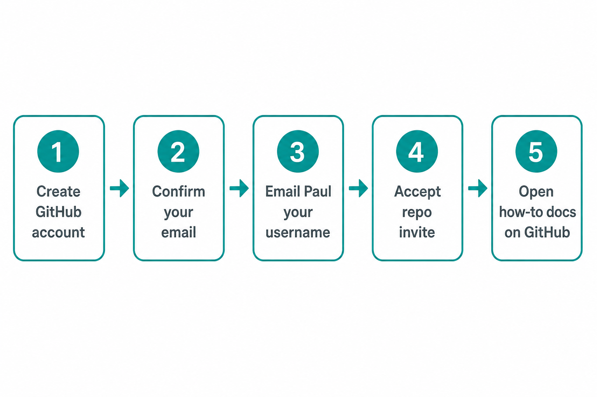
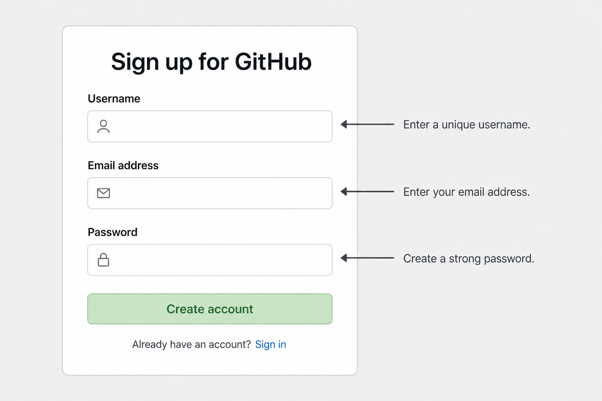
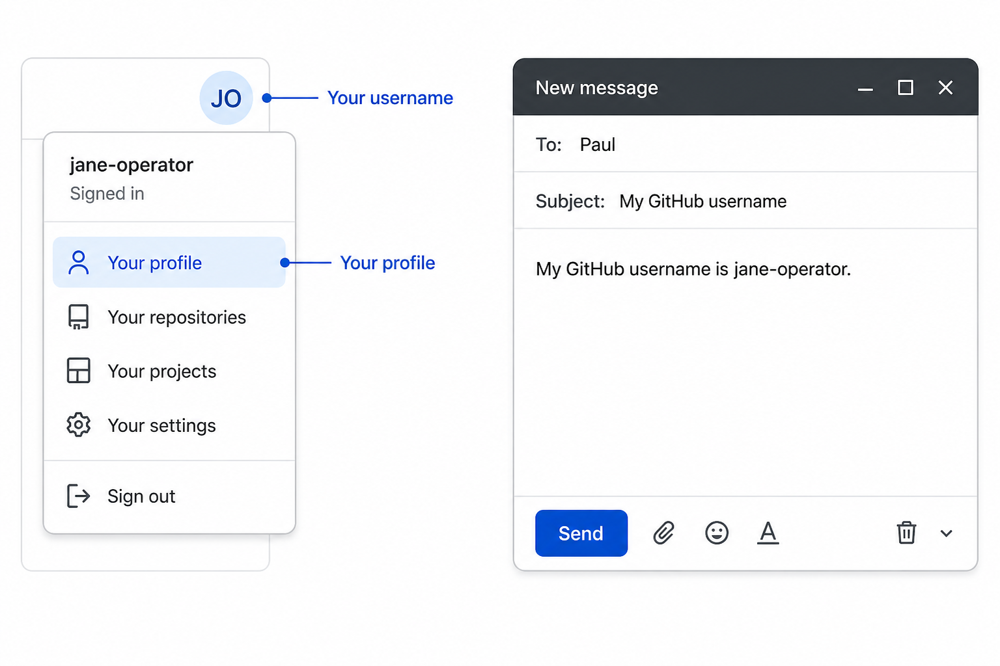
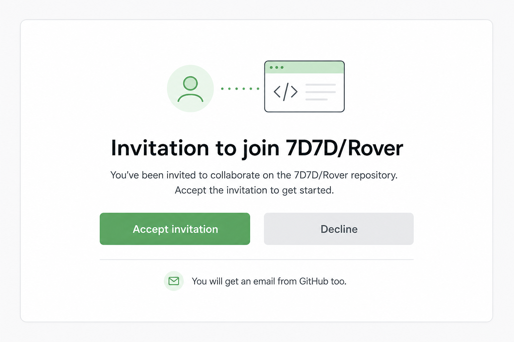
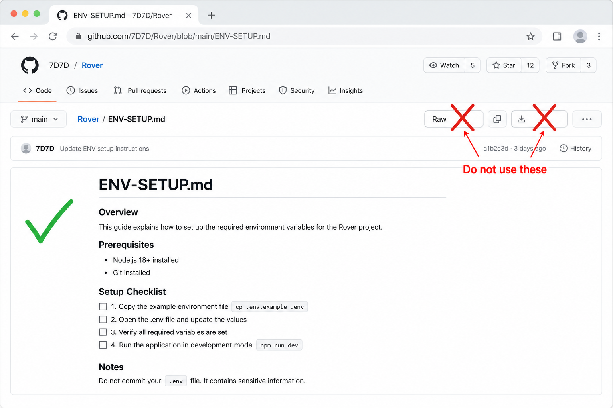

# Rover how-tos: get GitHub access (gateway)

This is the **starting document** for Rover operators. It is not about coding. It only gets you a free GitHub account, access to the private Rover folder of how-to guides, and shows you how to read those guides in a normal web browser.

After you finish, your first how-to is **Rover — from discovery to launch** (`USER-FLOW.md`). Next, set up keys with **Rover .env & API keys setup** (`ENV-SETUP.md`).



---

## For Paul (one-time: turn this into a Google Doc)

1. Create a blank [Google Doc](https://docs.google.com/).
2. Open [`GITHUB-ACCESS-GATEWAY.html`](GITHUB-ACCESS-GATEWAY.html) in a browser (double-click the file, or open it from the repo). Select all → Copy → Paste into the Doc.  
   If images do not paste, insert them from `docs/images/github-gateway/`.
3. Replace **YOUR_EMAIL** below with the address operators should use to send their username.
4. Share the Google Doc with operators as **Viewer**. Keep GitHub as the source of truth for USER-FLOW, ENV-SETUP, and other how-tos.

Operators: ignore this section. Start at **What this is**.

---

## What this is

Rover’s detailed instructions live in a private GitHub repository:

**https://github.com/7D7D/Rover**

GitHub is a website that stores files. You will use it like a library of how-to pages—not like a programming tool. You do **not** need Cursor, VS Code, or any developer software.

---

## Step 1 — Create a free GitHub account

1. Open **https://github.com/signup** in your browser (Chrome, Edge, or Safari).
2. Choose a **username** (letters, numbers, hyphens—this is public; pick something professional).
3. Enter an **email address** you can check.
4. Create a **password**.
5. Complete the puzzle / verification if asked.
6. Click **Create account** (wording may vary slightly).
7. If GitHub offers paid plans or “Pro” trials, choose the **free** option and skip extras.



### Confirm your email

1. Open your email inbox.
2. Find the message from GitHub (check Spam if needed).
3. Click the confirm / verify link.

You cannot fully use GitHub until the email is confirmed.

**Official link:** [Sign up for GitHub](https://github.com/signup)

---

## Step 2 — Tell Paul your GitHub username

Paul must invite you before you can see the private Rover docs.

1. Sign in at **https://github.com**.
2. Click your **profile picture** (usually top-right).
3. Your **username** appears near the top of that menu (and on “Your profile”).
4. Email Paul:

**To:** YOUR_EMAIL  

**Subject:** My GitHub username  

**Body:**

```
Hi Paul,

My GitHub username is: REPLACE_WITH_YOUR_USERNAME

Please invite me to the Rover docs repo.

Thanks
```



Wait until Paul confirms he sent the invite (often within a day).

---

## Step 3 — Accept the invitation

1. Check your email for a message from GitHub about an invitation to **7D7D/Rover**.
2. You can also open **https://github.com/notifications** while signed in and look for the invitation.
3. Open the invite page and click **Accept invitation**.



If the button is missing, sign out, sign back in with the **same** account whose username you sent Paul, and open the invite link again.

---

## Step 4 — How to read how-to docs on GitHub

1. Open a document link Paul sends you, or go to the repo: **https://github.com/7D7D/Rover**
2. Click the **docs** folder, then open a `.md` file (for example `USER-FLOW.md`).
3. Read the **main page** in the browser. Headings, links, and pictures should look normal.

**Do not** click **Raw** or **Download** for normal reading—those show code-like text or a file download instead of the friendly page.



Tips:

- Blue text is usually a clickable link.
- Pictures appear in the page; scroll slowly on long guides.
- Bookmark pages you use often.

---

## Step 5 — Your first how-to documents

After you can open the repo, read these **in order**:

1. **Rover — from discovery to launch** (what you do in the product, with time estimates)  
   https://github.com/7D7D/Rover/blob/master/docs/USER-FLOW.md

2. **Rover .env & API keys setup** (get Settings → API/Other green)  
   https://github.com/7D7D/Rover/blob/master/docs/ENV-SETUP.md

Other guides live in the same folder:

https://github.com/7D7D/Rover/tree/master/docs

Paul may send you additional links for Phone, metrics, and other topics as needed.

After ENV-SETUP, useful next reads: [USER-FLOW.md](https://github.com/7D7D/Rover/blob/master/docs/USER-FLOW.md) (already above) and [OPERATOR-CADENCE.md](https://github.com/7D7D/Rover/blob/master/docs/OPERATOR-CADENCE.md) (10 sites/day schedule).

---

## Troubleshooting

| Problem | What to try |
| --- | --- |
| **404** or “page not found” on the repo | You are not invited yet, or you are signed into a **different** GitHub account. Accept the invite, then try again while signed in. |
| No invite email | Check Spam; open https://github.com/notifications ; confirm Paul has your exact username. |
| Page looks like code (`#` headings, `[]()` links) | You opened **Raw**. Go back and open the normal file page (no Raw). |
| Images missing | Same as above—use the rendered file view, not Raw. |
| Forgot password | Use “Forgot password” on https://github.com/login |

---

## Quick checklist

1. Create account at https://github.com/signup  
2. Confirm email  
3. Email **YOUR_EMAIL** your GitHub username  
4. Accept invite to **7D7D/Rover**  
5. Open https://github.com/7D7D/Rover/blob/master/docs/USER-FLOW.md and read it  
6. Then open https://github.com/7D7D/Rover/blob/master/docs/ENV-SETUP.md and follow it  

You are done with this gateway when you can open those pages and read them in the browser.
