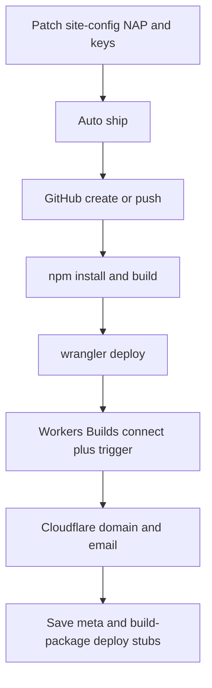

# Launch button reference

What **Run launch** does today in Rover → Content → Website builder (step **Launch**).

Broader assemble + deploy runbook: [ASSEMBLE-AND-LAUNCH.md](ASSEMBLE-AND-LAUNCH.md). Master pipeline: [MASTER-FLOW.md](MASTER-FLOW.md).

---

## 1. Entry points

| Entry | How |
| --- | --- |
| Rover UI | Content → Website builder → **Run launch** (disabled until the candidate is assembled) |
| CLI | `npm run launch-site -- <candidateId>` |
| API | `POST /api/candidates/:id/launch` with JSON body (same fields as the UI) |

CLI flags:

```powershell
npm run launch-site -- <candidateId>
npm run launch-site -- <candidateId> --skip-cloudflare
npm run launch-site -- <candidateId> --skip-ship
npm run launch-site -- <candidateId> --turnstile --destination=you@gmail.com
```

Related: `GET/POST /api/candidates/:id/ship` (ship only), `GET /api/candidates/:id/launch` (status, no secrets).

---

## 2. UI form and checkboxes

| Control | Default | Effect |
| --- | --- | --- |
| Domain | From accepted site-config | Written into site-config; used for CF zone + custom domain |
| Phone | From site-config | Written into site-config |
| Leads email | From site-config (or `leads@{domain}`) | Written into site-config; used as Email Routing matcher |
| Email Routing destination | Prefills from `WEB3FORMS_DEFAULT_NOTIFY_EMAIL` if empty | Gmail (or inbox) that receives forwarded `leads@` mail |
| Web3Forms access key | From site-config | Written into site-config; marks `formsDone` when real (not placeholder) |
| Turnstile site key | From site-config / optional | Written into site-config |
| **Auto ship** (GitHub + build + Worker deploy) | **On** | GitHub create/push, `npm` build, Wrangler deploy, Workers Builds connect |
| **Run Cloudflare domain / email API** | **On** | Zone lookup, Email Routing, custom domain attach |
| Create Turnstile widget | Off | Creates a CF Turnstile widget and writes the site key back |
| Mark CF Worker project done | Off | Forces meta `cloudflarePagesDone` even without a successful deploy |

---

## 3. Ordered pipeline



Ship failure does **not** abort Cloudflare domain/email steps. Uncheck Auto ship or Cloudflare to skip those blocks.

### 3.1 Preconditions

- Candidate must have an assembled site (`meta.assembledSitePath` exists on disk).
- Patching requires an accepted site-config (`Accept site-config first` if missing).

### 3.2 Patch site-config

Writes NAP / form fields into:

1. Research copy: `research/{id}-site-config.json` (via `pathsFor`)
2. Assembled site: `{assembled}/src/config/site-config.json`
3. Live template `src/config/site-config.json` **only if** `meta.siteConfigPath` is `src/config/site-config.json`

Fields applied when non-empty: `domain`, `phone`, `email`, `businessName`, `web3FormsAccessKey`, `turnstileSiteKey`.

`formsDone` is true when the Web3Forms key is set and is **not** a placeholder (`REPLACE_WEB3FORMS_KEY` / `YOUR_WEB3FORMS_ACCESS_KEY`).

### 3.3 Auto ship (if checked)

Runs in the assembled sibling folder (default under `ASSEMBLED_SITES_DIR` / `../rover-sites/{slug}`).

1. **GitHub** (`gh` CLI)
   - Requires `gh` installed and `gh auth login` once
   - Owner from `GITHUB_OWNER`, else `TEMPLATE_GITHUB_REPO` org, else `gh api user`
   - Commit with local Rover identity (`rover@local` / Rover); **clean tree / nothing to commit is success**
   - Private `gh repo create {owner}/{slug}` + push, or push existing `origin` `main`
   - Repo name = assemble slug (e.g. `omahaegresswindowpros-com`)

2. **Build** — `npm install` then `npm run build` in the assembled folder

3. **Wrangler deploy** — `npx wrangler deploy` using `CLOUDFLARE_ACCOUNT_ID` + `CLOUDFLARE_API_TOKEN`  
   - Skipped if Cloudflare env is not configured  
   - Creates/updates the Worker named in assembled `wrangler.json` (same as assemble slug)

4. **Workers Builds connect** (best-effort, after a successful GitHub step)
   - `PUT /accounts/{id}/builds/repos/connections` (GitHub owner/repo ids)
   - Creates a production trigger: build `npm run build`, deploy `npx wrangler deploy`, branch `main`
   - Needs a **user** API token with **Workers Builds Configuration → Edit**, plus the Cloudflare Workers and Pages GitHub App authorized once (dashboard Connect)
   - Soft-skips on auth/API failure; Worker remains live via Wrangler

Ship also updates meta: `lastShipAt`, `githubRepo`, `githubRepoUrl`, and may set `cloudflarePagesDone` / `cfProject` after deploy.

### 3.4 Cloudflare domain / email (if checked)

Requires `CLOUDFLARE_ACCOUNT_ID` + `CLOUDFLARE_API_TOKEN`. Worker name = `meta.assembledSiteSlug` or assembled folder basename.

1. **Find zone** for the domain (zone must already exist in the account — nameservers already at Cloudflare)
2. **Email Routing** (when destination email is set)
   - Try enable zone Email Routing — **soft-skip** on settings API auth errors (common); enable in dashboard if routing is not on yet
   - Ensure destination address via **account** API `…/accounts/{id}/email/routing/addresses` (not zone-scoped Addresses)
   - If destination is new / unverified, human must click the Gmail verification link once
   - Create or update rule: `leads@{domain}` (or Leads email field) → destination
3. **Custom domain**
   - Confirm Worker exists via `GET …/workers/scripts/{name}/settings` (assets-only Workers return empty on the bare script GET — that path is avoided)
   - Attach hostname → Worker (`PUT/POST …/workers/domains`)
4. **Turnstile** (only if Create Turnstile is checked) — create widget; write `turnstileSiteKey` back into site-config when created

### 3.5 Meta and build-package

After ship/CF, Launch saves candidate meta, including:

| Flag / field | Meaning |
| --- | --- |
| `lastLaunchAt` | Timestamp of this Launch run |
| `formsDone` | Real Web3Forms key present |
| `launchDomain` | Domain used |
| `githubRepo` / `githubRepoUrl` | From successful ship |
| `cloudflarePagesDone` | Worker deploy succeeded, Worker exists, or “Mark CF done” checked |
| `cfProject` | Worker / project name (assemble slug) |
| `dnsDone` | Custom domain attach succeeded |
| `emailRoutingDone` | Leads forward rule present without error |

If a build-package JSON exists for the candidate, refreshes `deploy.domain`, `deploy.cfProject`, `deploy.repoName`.

---

## 4. Soft-fails and common messages

| Message | Meaning | Action |
| --- | --- | --- |
| Zone Email Routing settings API unavailable | Enable/settings call soft-skipped (often 403) | Ignore if Email Routing is already on; otherwise enable in CF dashboard for the zone |
| Workers Builds GitHub connection skipped / Authentication error | Builds API could not connect repo | Worker still deployed via Wrangler. Check user token **Workers Builds Configuration Edit** + GitHub App (click Connect once in CF). Re-run Launch |
| Ship failed: … nothing to commit / Command failed: git commit | Older bug: clean tree treated as failure | Fixed — clean tree is success and push continues |
| Worker "…" not found | Worker missing or existence check failed | Re-run Launch after Auto ship deploy; assets Worker check uses `/settings` |
| No Cloudflare zone found | Domain not in this CF account | Add domain / point NS, then re-run |
| Create a form at web3forms.com… | Key missing or placeholder | Paste access key and re-run |

Launch result modal summarizes ship ok/partial, Cloudflare ok/partial, and forms key set vs placeholder.

---

## 5. Human leftovers (never fully automated)

1. **Buy the domain** and point nameservers at Cloudflare (zone must exist in the account)
2. **Create** the Web3Forms form at [web3forms.com](https://web3forms.com) and paste the access key (no public create-form API)
3. **Verify** Email Routing destination once when it is new (click link in Gmail)
4. **One-time machine setup** (not per site):
   - `gh auth login`
   - `.env`: `GITHUB_OWNER`, `CLOUDFLARE_ACCOUNT_ID`, `CLOUDFLARE_API_TOKEN`, optional `WEB3FORMS_DEFAULT_NOTIFY_EMAIL`
   - Authorize Cloudflare Workers and Pages GitHub App once for push-to-rebuild

---

## 6. Required env and token permissions

See [`.env.example`](../.env.example).

| Variable | Role |
| --- | --- |
| `CLOUDFLARE_ACCOUNT_ID` | Account for Wrangler + CF APIs |
| `CLOUDFLARE_API_TOKEN` | **User** API token (account-owned tokens fail Builds API) |
| `GITHUB_OWNER` | Org/user for per-site repos (optional if `gh` user / template remote resolves it) |
| `WEB3FORMS_DEFAULT_NOTIFY_EMAIL` | Prefills Email Routing destination in Launch UI |
| `ASSEMBLED_SITES_DIR` | Where Assemble writes sibling sites (default `../rover-sites`) |
| `TEMPLATE_GITHUB_REPO` | Optional; used to infer GitHub owner (default example `7D7D/Rover`) |

Suggested token permissions:

| Scope | Permission | Level |
| --- | --- | --- |
| Account | Workers Scripts | Edit |
| Account | Workers Builds Configuration | Edit (push-to-rebuild / Builds connect) |
| Account | Email Routing Addresses | Edit |
| Account | Turnstile | Edit |
| Account | Account Settings | Read |
| Zone | Email Routing Rules | Edit |
| Zone | Zone | Read |
| Zone | DNS | Edit |

There is usually **no** separate “Workers CI” row in the token UI; that name is API-internal. Keep **Workers Scripts** + **Workers Builds Configuration**.

API calls are **$0**. You pay for the domain and stay on free tiers for typical static Workers + Email Routing + Web3Forms free-tier submissions.

---

## 7. Code map

| Layer | File / symbol |
| --- | --- |
| Rover UI (form + POST) | [`ops/public/app.js`](../ops/public/app.js) `#ca-launch` |
| HTTP route | [`ops/server.mjs`](../ops/server.mjs) `POST /api/candidates/:id/launch` |
| Orchestrator | [`ops/lib/launch-site.mjs`](../ops/lib/launch-site.mjs) `launchSite`, `patchLaunchSiteConfig`, `getLaunchStatus` |
| CLI | [`ops/lib/run-launch.mjs`](../ops/lib/run-launch.mjs) |
| Ship (build / deploy / Builds) | [`ops/lib/ship-site.mjs`](../ops/lib/ship-site.mjs) `shipAssembledSite`, `connectWorkersBuilds` |
| GitHub push | [`ops/lib/github-site.mjs`](../ops/lib/github-site.mjs) `pushAssembledSiteToGithub` |
| Cloudflare helpers | [`ops/lib/cloudflare-launch.mjs`](../ops/lib/cloudflare-launch.mjs) `runCloudflareLaunch`, `workerExists`, Email Routing, custom domain |
