# Rank & Rent — master flow

Shareable overview of the full project: how a market becomes a live lead-gen site, and which tools do which work.

**What this is:** A Rank & Rent system finds local niches worth ranking for, then ships a static lead-gen website per market. You rent the site (or its leads) to a local operator. One **master template** plus a local **ops dashboard** drive the pipeline; each live site is its **own GitHub repo** hosted on **Cloudflare Workers**. Forms go through **Web3Forms**; `leads@` mail uses **Cloudflare Email Routing**.

---

## Master flowchart

Phases read **left to right in two rows**; sub-steps stack vertically inside each phase box. Nodes marked **human** are still manual.

```mermaid
flowchart TB
  subgraph row1 [Phases 1 to 5]
    direction LR

    subgraph disc [1 Discover markets]
      direction TB
      d1["Census place seeds"] --> d2["Create discovery pack"]
      d2 --> d3["Process batch"]
      d3 --> d4["Candidate list in ops"]
    end

    subgraph res [2 Research SERP]
      direction TB
      r1["Stage 1 SERP and keywords"] --> r2["Stage 2 enrich when recommended"]
      r2 --> r3["Optional Stage 4 renter prospects"]
    end

    subgraph dec [3 Decide pursue]
      direction TB
      e1["Claude narrative draft"] --> e2["Human Accept or reject"]
      e2 --> e3["Pursue gate unlocks build"]
    end

    subgraph scfg [4 Site config]
      direction TB
      s1["NAP plus Claude prompt"] --> s2["Paste or edit draft"]
      s2 --> s3["Accept site-config.json"]
    end

    subgraph cont [5 Content]
      direction TB
      c1["Researcher pack"] --> c2["Outline"]
      c2 --> c3["Writer homepage-first"]
      c3 --> c4["Accept markdown"]
    end

    disc --> res --> dec --> scfg --> cont
  end

  subgraph row2 [Phases 6 to 10]
    direction LR

    subgraph stg [6 Stage preview]
      direction TB
      t1["Stage homepage to site-staging"] --> t2["Astro preview QA"]
    end

    subgraph asm [7 Assemble]
      direction TB
      a1["Assemble sibling site folder"] --> a2["Local npm run build smoke"]
    end

    subgraph ship [8 GitHub plus CF Worker]
      direction TB
      h1["gh repo create and push — human"] --> h2["CF Workers Builds connect — human"]
      h2 --> h3["First deploy via Wrangler"]
    end

    subgraph launch [9 Launch]
      direction TB
      l1["Buy domain and point NS — human"] --> l2["Create Web3Forms form — human"]
      l2 --> l3["Paste access key in ops Launch"]
      l3 --> l4["Ops Launch Email Routing and custom domain"]
      l4 --> l5["Verify Gmail destination — human"]
      l5 --> l6["Commit and push for CF rebuild"]
    end

    subgraph live [10 Live / rent]
      direction TB
      v1["Form and leads@ receive leads"] --> v2["Hand off site or leads to renter"]
    end

    stg --> asm --> ship --> launch --> live
  end

  cont --> stg
```

Open on GitHub or [mermaid.live](https://mermaid.live) to view the rendered boxes (paste the `mermaid` code block). Left-to-right in two rows.

### Steps: what happens and why

| Step | What happens | Why it exists |
| --- | --- | --- |
| **1 · Discover markets** | Ops discovery packs + census place seeds shortlist niches/cities. | Avoid building sites in dead markets; start from population and niche fit. |
| **2 · Research SERP** | DataForSEO SERP/keywords (and related signals) score opportunity. | Prove search demand and that competition is beatable before spending content time. |
| **3 · Decide pursue** | Claude narrative + human Accept; decision = pursue / skip. | Gate expensive work (site-config, content, domain) to winners only. |
| **4 · Site config** | Lock business name, domain, phone, email, services, suburbs, brand. | One JSON source of truth so pages, schema, and CTAs stay consistent. |
| **5 · Content** | Researcher → outline → writer → Accept markdown pages. | Local SEO pages (home, about, contact, services, locations) that match the config. |
| **6 · Stage preview** | Copy into `research/{id}/site-staging/` and preview in Astro. | Catch wrong market/content before cloning a whole site repo. |
| **7 · Assemble** | Copy template + inject staging into `rank-and-rent-sites/{slug}`. | Isolate each domain in its own folder/repo (clone-per-site). |
| **8 · GitHub + CF Worker** | Push site repo; Cloudflare Workers Builds deploys `dist` via Wrangler. | Cheap global hosting with one Worker project per site. |
| **9 · Launch** | Paste Web3Forms key; ops Launch attaches domain + Email Routing (API). | Go live on the real domain with working form and `leads@` inbox. |
| **10 · Live / rent** | Leads hit inbox/form; hand site or leads to a local renter. | The business model: ranked site → rented asset. |

### Still human (API cannot fully automate)

- **Buy the domain** and point nameservers at Cloudflare (step 8–9).
- **First** GitHub repo create + Workers Builds project connect (step 8).
- **Create** a Web3Forms form and paste the access key (step 9).
- **Verify** Email Routing destination once (click link in Gmail) (step 9).
- **Commit + push** after Launch writes keys so CF rebuilds (step 9).

Detailed runbook: [ASSEMBLE-AND-LAUNCH.md](ASSEMBLE-AND-LAUNCH.md).

---

## Tools legend

| Tool | Used for |
| --- | --- |
| Ops dashboard (`npm run ops`) | Local pipeline UI / orchestration |
| DataForSEO | SERP, keywords, maps, enrichment signals |
| Census places CSV | City/population seeds for discovery |
| Claude (Anthropic) | Narrative, site-config draft, content writing |
| Astro + Tailwind | Site template / static pages |
| Local IDE / Cursor | Edit template, ops, prompts |
| GitHub | Template repo + one repo per live site |
| Cloudflare Workers | Host/build/deploy static site |
| Cloudflare Email Routing | `leads@` → inbox |
| Cloudflare Turnstile | Optional form spam protection |
| Web3Forms | Contact form → email |
| Domain registrar | Buy/point domain nameservers |
| Gmail (or inbox) | Receive routed mail + form notify |
| Wrangler / CF Builds | `npx wrangler deploy` in CI |

---

## Tools × steps matrix

`X` = that tool is actively used in that step.

| Tool | 1 Discover | 2 Research | 3 Decide | 4 Site config | 5 Content | 6 Stage | 7 Assemble | 8 Ship | 9 Launch | 10 Live |
| --- | :---: | :---: | :---: | :---: | :---: | :---: | :---: | :---: | :---: | :---: |
| Ops dashboard | X | X | X | X | X | X | X | | X | |
| DataForSEO | X | X | | | | | | | | |
| Census places CSV | X | | | | | | | | | |
| Claude (Anthropic) | | | X | X | X | | | | | |
| Astro + Tailwind | | | | | X | X | X | X | | X |
| Local IDE / Cursor | X | X | X | X | X | X | X | X | X | |
| GitHub | | | | | | | X | X | X | |
| Cloudflare Workers | | | | | | | | X | X | X |
| Cloudflare Email Routing | | | | | | | | | X | X |
| Cloudflare Turnstile | | | | | | | | | X | X |
| Web3Forms | | | | | | | | | X | X |
| Domain registrar | | | | | | | | X | X | |
| Gmail (or inbox) | | | | | | | | | X | X |
| Wrangler / CF Builds | | | | | | | | X | | |

---

## Costs (stage and tool)

Estimates align with ops pre-run modals ([`ops/lib/cost-estimates.mjs`](../ops/lib/cost-estimates.mjs)). DataForSEO and Claude figures are **estimates**, not invoices; provider list prices change.

**Rough all-in per new site (research + content + domain year 1):** about **$11–$20** on free hosting/forms (domain dominates). Typical pursue-path API/AI spend is often **~$1–$5** without heavy enrich.

### Per-stage variable costs

| Stage | Primary tools | Typical cost / site (USD) | Notes |
| --- | --- | --- | --- |
| 1 Discover | Ops, Census CSV, Claude (pick rows), DataForSEO SERP probe | ~$0.002/row probe + small Claude | Probe is cheap; Claude for pack narrative varies by tokens |
| 2 Research | DataForSEO Stage 1 | ~$0.20–$1.50 | Ads volumes × cities/keywords; lower if SERP cache reused |
| 2b Enrich | DataForSEO Stage 2 | ~$0.05–$0.80 | ~$0.05/URL clamped; only when recommended |
| 2c Prospects | DataForSEO Stage 4 | ~$0.05–$0.40 | Optional; does not block build |
| 3 Decide | Claude narrative | ~$0.05–$0.50 est. | Sonnet list ~$3/$15 per MTok; not an invoice |
| 4 Site config | Claude draft | ~$0.02–$0.20 est. | One JSON draft |
| 5 Content | Claude researcher / outline / writer | ~$0.20–$2.00 est. | Largest Claude spend; homepage-first is cheaper than full suite |
| 6–7 Stage / Assemble | Ops, Astro, local machine | $0 | No paid API |
| 8 Ship | GitHub, CF Workers, Wrangler | $0 on free tiers | Still buy domain separately |
| 9 Launch | Web3Forms, CF Email Routing, Turnstile, registrar | Domain ~$10–15/yr; APIs $0 | Web3Forms free ~250 submissions/mo |
| 10 Live / rent | Web3Forms, Email Routing, Gmail | $0 until form volume / paid CF | Optional later: call tracking (Twilio/CallRail) not in this table |

### Per-tool billing

| Tool | Billing model | Rank & Rent use cost |
| --- | --- | --- |
| Ops dashboard | Local free | $0 |
| Census CSV | In-repo | $0 |
| DataForSEO | Pay-as-you-go API | See stage ranges above |
| Claude (Anthropic) | Token usage | See stage ranges; model override via `ANTHROPIC_MODEL` |
| Astro / Tailwind / IDE | Local / free | $0 |
| GitHub | Free private OK for this scale | $0 |
| Cloudflare Workers | Free tier (~100 Workers) | $0 typical static |
| CF Email Routing | Free inbound | $0 |
| CF Turnstile | Free typical | $0 |
| CF Management API | No per-call fee | $0 |
| Web3Forms | Free ~250/mo; paid ~$5–18+/mo | $0 until over free |
| Domain registrar | Annual | ~$10–15/site/year |
| Gmail | Free | $0 |

Does not include your time, phone tracking (Twilio/CallRail), or analytics add-ons.

---

## Out of scope

Images polish, template design tweaks, and deep SEO compare work are parked in [BACKLOG.md](BACKLOG.md). This flowchart is the **production path** from discovery to a rentable live site.
