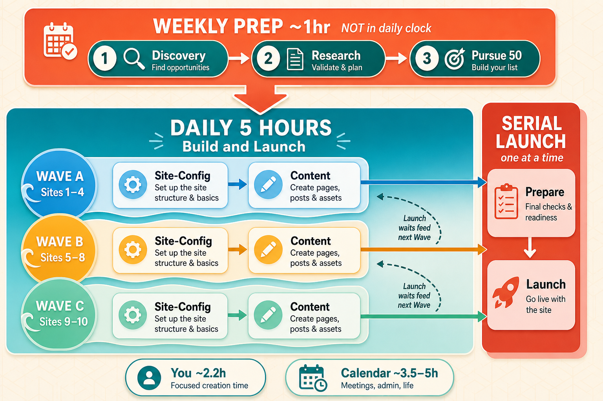
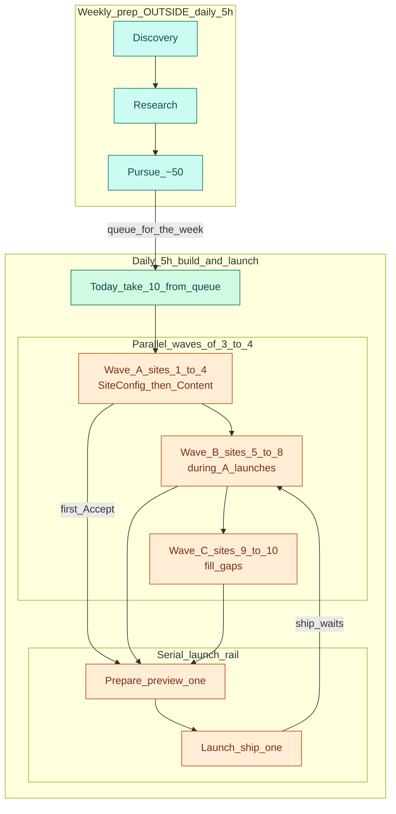

# Operator cadence — flowchart

Visual map of **weekly prep** (outside the day) vs the **daily 5-hour** build/launch block. Full narrative: [OPERATOR-CADENCE.md](OPERATOR-CADENCE.md).

**Best view:** open the colorful interactive page → [OPERATOR-CADENCE-FLOW.html](OPERATOR-CADENCE-FLOW.html) (double-click in Finder/Explorer, or open from the `docs` folder).

---

## Two clocks at a glance

---

## Legend

| Color / lane | Meaning |
|--------------|---------|
| Teal weekly strip | **Not** in the daily 5h — Discovery → Research → ~50 pursue |
| Blue / amber / mint waves | Parallel Site-Config + Content (3–4 sites) |
| Coral launch rail | **One at a time** — Prepare (`:4322`) then Launch |
| Metrics | **You ~2.2h** hands-on · **Calendar ~3.5–5h** until 10 live |

---

## Rules etched on the chart

1. Weekly prep clock ≠ daily 5h clock.
2. Parallelize Content across candidates (prefer one Rover window + multiple Claude chats).
3. Never overlap Prepare / Launch; never the same candidate in two tabs.
4. Use ship waits to advance the next wave.

---

## Related

- [OPERATOR-CADENCE.md](OPERATOR-CADENCE.md) — full schedule math
- [USER-FLOW.md](USER-FLOW.md) — per-step times
- [OPERATOR-CADENCE-FLOW.html](OPERATOR-CADENCE-FLOW.html) — colorful HTML poster
