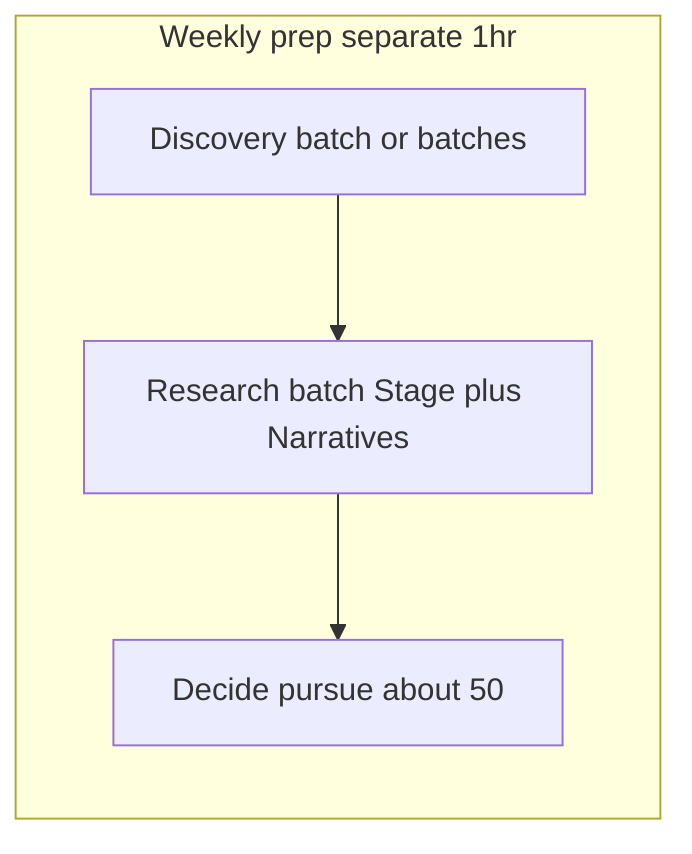
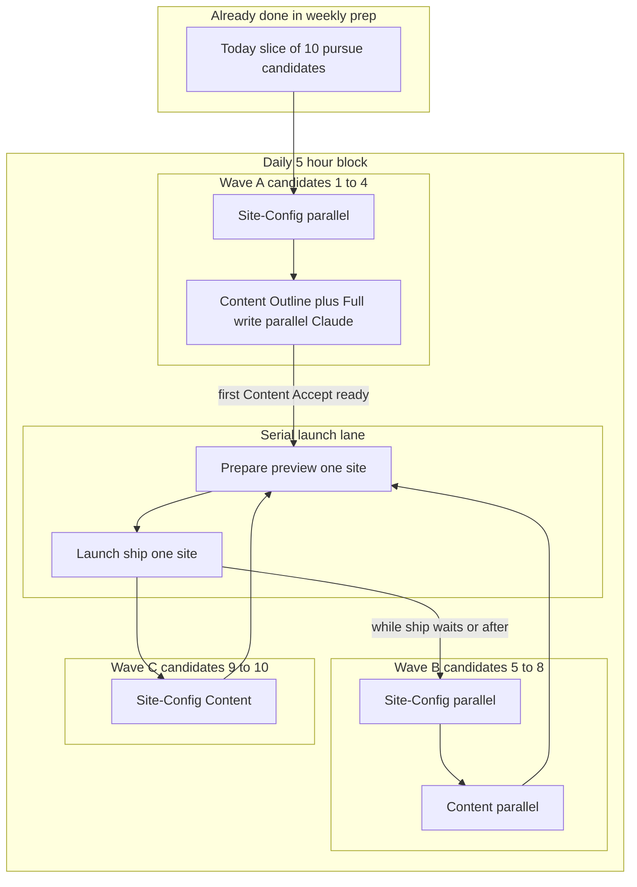

# Operator cadence — 10 sites / day in ~5 hours

How to schedule Rover work: a **weekly prep** job (separate clock) plus a **daily build/launch** block. Step times come from [USER-FLOW.md](USER-FLOW.md).

**Flowchart (color):** [OPERATOR-CADENCE-FLOW.md](OPERATOR-CADENCE-FLOW.md) · open [OPERATOR-CADENCE-FLOW.html](OPERATOR-CADENCE-FLOW.html) in a browser for the full poster.

## Two separate jobs (do not mix the clocks)

| Job | When | Scope | Counts toward daily 5h? |
|-----|------|--------|-------------------------|
| **Weekly prep** | Outside the normal day (e.g. weekend) | Discovery + Research + decide **~50 pursue** for next week (10/day × 5 days) | **No** — separate ~1 hr/week budget |
| **Daily build day** | 5-hour work block | Take **today’s 10** already-pursued candidates through Site-Config → Content → Launch | **Yes** — this is the only clock below |

Daily math **starts with 10 candidates already in Website Builder (pursue)**. Discovery, SERP probe, Narrative, Enrich, and promote are **not** part of the daily total.

---

## Verdict (daily only)

Parallel Site-Config / Content across candidates works; **Prepare preview / Launch** stay **one site at a time**.

Excluding weekly prep:

- **Hands-on (“You”)** for 10 sites (Site-Config → Launch): ~10 × 13 min ≈ **~2.2 hours**
- **Wall-clock if fully serial**: ~10 × 44 min ≈ **~7+ hours** (does not fit in 5h)
- **Calendar with overlap**: about **3.5–4.5 hours** typical; **5 hours** is a comfortable buffer

You can hit 10 in 5 hours; often finish sooner if Claude is mid-range, domains are pre-bought, and you keep **3–4** candidates in flight (not 5+).

### “You” vs calendar (same day)

| Metric | Ideal day | Meaning |
|--------|-----------|---------|
| **You (hands-on)** | ~2.2 h | Clicks, pastes, Accepts only |
| **Calendar** | ~3.5–5 h | Clock time until the 10th site is live |

Calendar is longer because Claude Full write, assemble, and serial ship still need **elapsed** time even when you overlap waits across candidates.

---

## Weekly prep (separate ~1 hr — not in daily 5h)

**Goal:** leave next week with **~50 pursue** candidates queued (10 ready per day).

**Caveat:** full Research on 50 (even skip Enrich) is roughly ~50 × ~2 min **active** ≈ **~1.5–2 h hands-on** plus waits, unless you heavily batch Stage 1–2, parallelize Narratives, and skim hard. Treat **1 hr/week** as the budget you want; extend weekly prep if quality slips—still **do not** fold that time into the daily 5h.

---

## Daily flow (5h block — build + launch only)

**Parallel:** Site-Config, Content outline/full-write (multiple Claude chats), Accept when each returns. Prefer one Rover window + multi-select where supported.

**Serial only:** Prepare preview (`:4322`), Assemble, Launch / Push updates. Never the same candidate in two tabs.

**Do not parallelize:** same candidate in two tabs; same Discovery batch in two tabs; overlapping Prepare/Launch.

---

## Recommended daily shape

Sweet spot: **waves of 3–4**, not 5.

| Wave | Candidates | What you do |
|------|------------|-------------|
| A | 1–4 | Site-Config → kick Content Full writes (parallel Claude) |
| Launch lane | As each Accepts | Prepare → Launch **one by one**; ship waits → start Wave B |
| B | 5–8 | Same while Wave A launches |
| C | 9–10 | Short wave in remaining gaps |

---

## Daily time math (Site-Config → live only)

Per site midpoints from [USER-FLOW.md](USER-FLOW.md) (**no** Discovery/Research):

| Phase | You | Waiting | Notes when parallelized |
|-------|----:|--------:|-------------------------|
| Site-Config | ~3 min | ~4 min | Overlap across wave |
| Content | ~2 min | ~20 min | Full write ~15 min — main overlap win |
| Launch | ~8 min | ~7 min | Domain/Web3Forms + serial ship |
| **Per site** | **~13 min** | **~31 min** | |

**10 sites hands-on:** ~130 min (~2.2 h) — daily **You** budget only.

| Daily scenario | Approx calendar in the 5h block |
|----------------|----------------------------------|
| Ideal (domains ready, Claude mid, waves of 3–4) | **~3.5–4 h** |
| Comfortable (some lag, light QA) | **~4.5–5 h** |
| Domains bought live + retries | **>5 h** |

---

## Faster inside the daily block?

| Idea | Effect |
|------|--------|
| Pre-buy today’s 10 domains / NS ready | Saves ~30–40 min hands-on **in the day** |
| Waves of 3–4 (not 5) | Same speed, fewer errors |
| Preset C + trust Claude skim | Keeps ~13 min you/site |
| Do **not** parallel Launch | Avoids preview/CF mix-ups |

Weekly prep improvements help **next week’s queue**, not today’s 5h arithmetic.

---

## Practical rules

1. **Weekly (outside daily routine):** Discovery + Research → ~50 pursue for next week (~1 hr budget, separate clock).
2. **Each day:** Pull 10 from that queue; waves of **3–4** through Content Accept; serial Prepare/Launch.
3. **Daily 5h** = build + launch only — **never** count weekly prep against it.
4. **Target:** 10 live in **~4 hours** of the day; keep **5 hours** as buffer.

---

## Related docs

| Doc | When you need it |
|-----|------------------|
| [USER-FLOW.md](USER-FLOW.md) | Step-by-step product map + per-step times |
| [ENV-SETUP.md](ENV-SETUP.md) | API keys / `.env` before first batch |
| [PIPELINE-STAGES.md](PIPELINE-STAGES.md) | Funnel definitions |
| [ASSEMBLE-AND-LAUNCH.md](ASSEMBLE-AND-LAUNCH.md) | Assemble / ship deep dive |
| [LAUNCH.md](LAUNCH.md) | Launch button reference |
