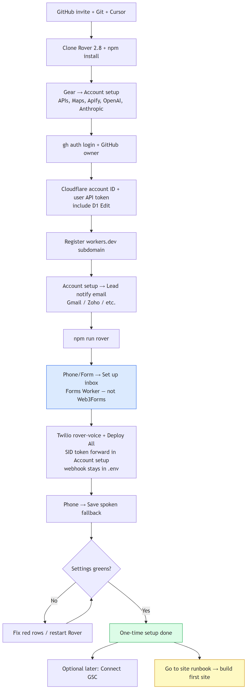
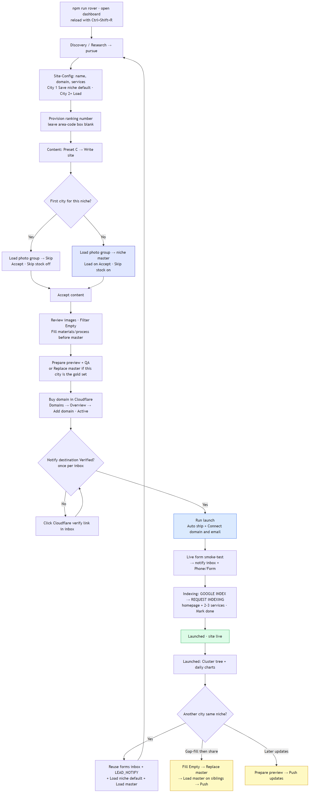

# Rover operator flowcharts (2.8)

Visual maps for the operator manuals. **Keep these in sync** whenever the one-time setup or site-runbook steps change (see checklist below).

| Download | Format |
| --- | --- |
| [flows/one-time-setup.png](flows/one-time-setup.png) | PNG — one-time setup |
| [flows/running-the-app.png](flows/running-the-app.png) | PNG — running the app |
| [flows/one-time-setup.svg](flows/one-time-setup.svg) | SVG — one-time setup |
| [flows/running-the-app.svg](flows/running-the-app.svg) | SVG — running the app |
| [flows/operator-flows.html](flows/operator-flows.html) | HTML — open in browser → **Print / Save as PDF** |
| [flows/one-time-setup.mmd](flows/one-time-setup.mmd) / [flows/running-the-app.mmd](flows/running-the-app.mmd) | Mermaid source |

Manuals: [OPERATOR-ONE-TIME-SETUP.md](OPERATOR-ONE-TIME-SETUP.md) · [OPERATOR-SITE-RUNBOOK.md](OPERATOR-SITE-RUNBOOK.md)

---

## Maintenance checklist (update flowcharts with the instructions)

When you change **operator instructions**, update the matching flowchart in the **same change**.

| Done? | When you edit… | Also update… |
| --- | --- | --- |
| ☐ | [OPERATOR-ONE-TIME-SETUP.md](OPERATOR-ONE-TIME-SETUP.md) (steps, order, required vs optional) | [flows/one-time-setup.mmd](flows/one-time-setup.mmd) → regenerate PNG/SVG → [flows/operator-flows.html](flows/operator-flows.html) (diagram 1) → this page’s embedded image if the caption changes |
| ☐ | [OPERATOR-SITE-RUNBOOK.md](OPERATOR-SITE-RUNBOOK.md) (per-site path, launch, forms) | [flows/running-the-app.mmd](flows/running-the-app.mmd) → regenerate PNG/SVG → [flows/operator-flows.html](flows/operator-flows.html) (diagram 2) |
| ☐ | Forms / notify / Web3Forms / Launch lead-mail wording in [ENV-SETUP.md](ENV-SETUP.md), [LAUNCH.md](LAUNCH.md), or [ASSEMBLE-AND-LAUNCH.md](ASSEMBLE-AND-LAUNCH.md) | Both flowcharts if boxes or “Do not use Web3Forms” wording would be wrong |
| ☐ | After regenerating assets | Confirm [OPERATOR-FLOWS.md](OPERATOR-FLOWS.md) still links the new files; bump a one-line note in [CHANGELOG.md](CHANGELOG.md) if the operator path changed |

**Regenerate PNG/SVG** (from the Rover root):

```powershell
.\scripts\render-operator-flows.ps1
```

That script updates `docs/flows/*.png` and `docs/flows/*.svg` from the `.mmd` sources. Edit the `.mmd` files first, then run the script, then align `operator-flows.html` if node labels changed.

---

## 1. One-time setup (once per machine)



---

## 2. Running the app (each new site)



**Remember:** contact forms use the Rover forms Worker — not Web3Forms.
