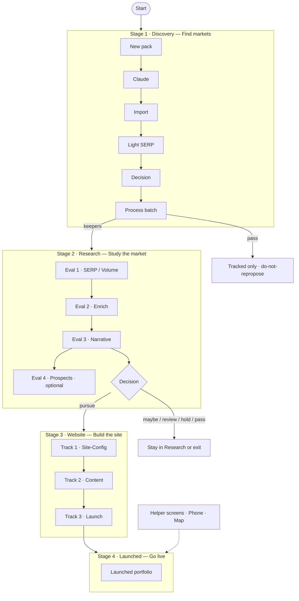
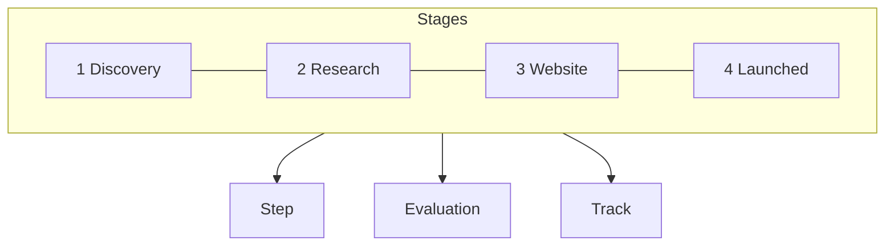

# Rover — work flow & naming

Plain-language charts for operators. Detailed time estimates live in [USER-FLOW.md](USER-FLOW.md).

## Work flow

Find markets → study them → build the site → go live.

Most markets stop early on purpose. Only **pursue** becomes a **Website Candidate** and gets a full site.

## Naming structure

| Term | Meaning |
| ---- | ------- |
| **Stage** | Top-bar pipeline: 1 Discovery → 2 Research → 3 Website → 4 Launched |
| **Evaluation** | Numbered checklist inside Research (SERP/Volume → Prospects) |
| **Track** | Numbered checklist inside Website (Site-Config → Content → Launch) |
| **Step** | Numbered action inside Discovery or inside a Track |

**Easy mix-ups:** Light SERP is a Discovery **Step**, not Research Evaluation 1. **Site research** is a Content Track step (not “field research” in the UI).
